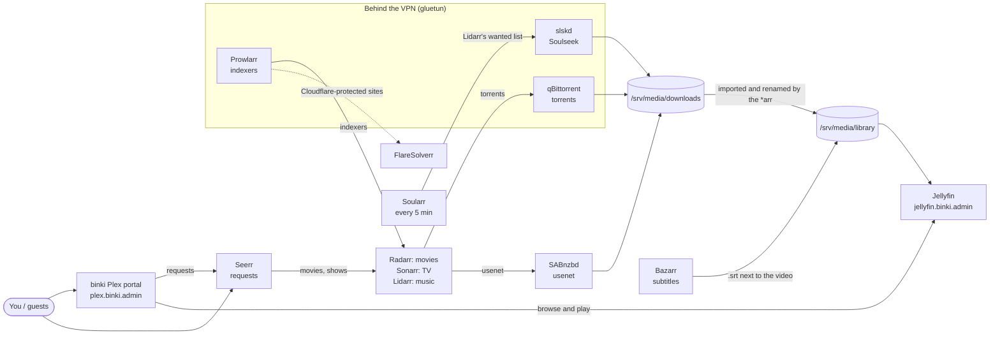
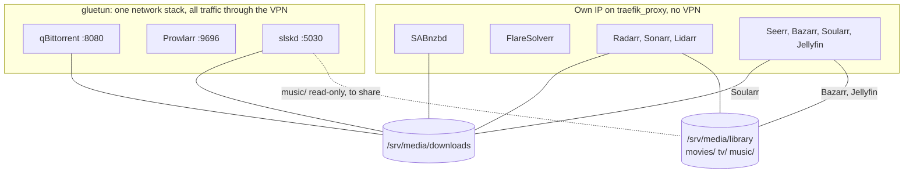

# Media stack

How the containers in binki-infra's `media/docker-compose.yml` work together: who asks whom for what, where files land, and which traffic goes through the VPN.

## From request to playback

1. **Asking for something.** Movies and shows are requested in Seerr, directly or through the binki Plex portal. Seerr hands movies to Radarr and shows to Sonarr. Music isn't requested through Seerr: you add artists in Lidarr.
2. **Finding it.** Radarr, Sonarr and Lidarr search the indexers that Prowlarr manages and syncs to them. For sites behind Cloudflare's bot check, Prowlarr goes through FlareSolverr.
3. **Downloading.** Torrents go to qBittorrent and usenet to SABnzbd. For music, Soularr checks Lidarr's wanted list every 5 minutes and fetches what's missing from Soulseek with slskd.
4. **Filing it.** Everything lands in `/srv/media/downloads`. The *arr app that asked for it renames it and moves it into the library.
5. **Subtitles.** Bazarr reads the movie and show lists from Radarr and Sonarr, and puts subtitle files next to the videos.
6. **Watching.** Jellyfin serves the library. The binki Plex portal is the friendlier front end on top of Jellyfin and Seerr, and it is the only part open to guests (port 8443).

## Files and the VPN

| Container   | VPN | `/srv/media/downloads` | `/srv/media/library`        |
| ----------- | --- | ---------------------- | --------------------------- |
| qBittorrent | yes | read/write             |                             |
| Prowlarr    | yes |                        |                             |
| slskd       | yes | read/write             | `music/`, read-only (share) |
| SABnzbd     | no  | read/write             |                             |
| Radarr      | no  | read/write             | `movies/`                   |
| Sonarr      | no  | read/write             | `tv/`                       |
| Lidarr      | no  | read/write             | `music/`                    |
| Soularr     | no  | read/write             |                             |
| Bazarr      | no  |                        | all of it                   |
| Jellyfin    | no  |                        | all of it                   |
| Seerr       | no  |                        |                             |

Things worth knowing:

- **Same paths everywhere.** The download clients and the *arr apps all mount `/srv/media/downloads` as `/downloads`, so a path that qBittorrent reports is valid in Radarr too. The library is a separate mount (`/movies`, `/tv`, `/music`), so an import is a copy then a delete, not an instant move or hardlink; mounting all of `/srv/media` as one path would change that.
- **One network for three containers.** qBittorrent, Prowlarr and slskd use `network_mode: service:gluetun`: they have no IP of their own, and their ports are gluetun's. Other containers reach them at gluetun (`172.21.10.2`), e.g. Prowlarr at `gluetun:9696`. If gluetun is recreated, `deploy.sh` recreates these three, because their network would otherwise be gone.
- **Kill switch.** When the VPN is down, gluetun blocks traffic, so those three stop instead of leaking your IP.
- **Not everything is behind the VPN.** SABnzbd connects to your usenet provider over TLS from the server's own IP, which is normal for usenet. FlareSolverr also fetches from its own IP, so the Cloudflare-check pages it solves for Prowlarr see the server's address.
- **Plain HTTP inside WireGuard.** The media hosts use Traefik's `web` entrypoint (port 80), not `websecure`.
